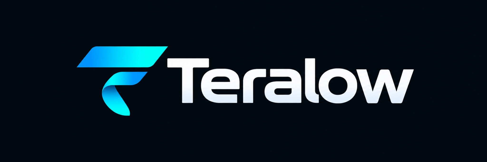

 <div align="center">



### High frames. Low ping. Linux first.

**A Linux-first, low-latency remote desktop and game streaming platform.**

Built to bring the simplicity and responsiveness of Parsec to Linux, with native hosting, browser access, immersive controls and a focus on security.

[](https://github.com/WhisteriaStudios/Teralow)
[](https://github.com/WhisteriaStudios/Teralow)
[](https://www.rust-lang.org/)
[](#licensing)

**[Features](#features--development-status) • [Roadmap](#development-roadmap) • [Getting Started](#getting-started) • [Licensing](#licensing)**

</div>

---

## 🚀 What is Teralow?

Teralow is a source-visible remote desktop platform being developed to deliver high-performance remote access, with Linux as a first-class host operating system.

The aim is simple: connect to your computer from almost anywhere, with the responsiveness needed for gaming, creative applications and everyday desktop usage.

Existing remote desktop solutions often make compromises between performance, ease of use, platform compatibility and accessibility.

Teralow aims to bring these experiences together.

### 🎯 Core objectives

- **Linux First:** Native Linux hosting, with Wayland support as a primary development target.
- **Low Latency:** High-framerate streaming designed for responsive remote desktop and gaming experiences.
- **Immersive Controls:** Relative mouse input, keyboard control and gamepad support.
- **Browser Access:** Connect from supported web browsers without requiring a separately installed client.
- **Cross-Platform:** Expand support to Windows, macOS and other platforms over time.
- **Security:** Authenticated, encrypted connections and carefully controlled remote-access permissions.
- **Source Visibility:** Publicly inspectable source code for transparency and community feedback.

---

## 🚦 Features & Development Status

Teralow is currently in the early stages of development. The following checklist reflects the state of the project, including functionality verified through independent prototype tests.

### Status legend

| Symbol | Status | Description |
|:---:|---|---|
| 🟢 | **Working** | Implemented and verified at the stated development stage |
| 🟡 | **In Progress** | Under active development |
| ⚪ | **Planned** | Intended for a future release |

### 🖥️ Linux Host

| Status | Feature | Notes |
|:---:|---|---|
| 🟢 | Hardware Discovery | OS, CPU, RAM and NVIDIA GPU identification |
| 🟢 | Encoder Discovery | GStreamer encoder detection |
| 🟢 | NVIDIA H.264 Encoding | Successfully tested using synthetic video |
| 🟢 | Wayland ScreenCast Portal | KDE screen-sharing authorisation verified |
| 🟢 | PipeWire Remote Connection | Authorised connection successfully opened |
| 🟢 | Capture Session Management | Start, maintain and close portal sessions |
| 🟢 | Desktop Frame Capture | Retrieve real desktop frames through PipeWire |
| 🟢 | Continuous Desktop Capture | Real-time frame processing |
| 🟡 | Hardware-Accelerated Streaming | Connect desktop capture to hardware encoding |
| ⚪ | Desktop Audio Capture | PipeWire audio integration |
| ⚪ | Unattended Access | Secure connections without an active local user |
| ⚪ | Login Screen Access | Remote access through supported login managers |

### 🎮 Streaming & Performance

| Status | Feature |
|:---:|---|
| ⚪ | H.264 Real-Time Streaming |
| ⚪ | HEVC / H.265 Streaming |
| ⚪ | AV1 Streaming |
| ⚪ | 1080p at 60 FPS |
| ⚪ | High Refresh Rate Support (120/144 FPS+) |
| ⚪ | Adaptive Bitrate |
| ⚪ | Low-Latency Network Transport |
| ⚪ | Hardware-Accelerated Decoding |
| ⚪ | 4:4:4 Colour Mode |
| ⚪ | Dynamic Resolution Scaling |
| ⚪ | Frame Timing & Latency Statistics |
| ⚪ | Network Congestion Management |

### 🖱️ Remote Input & Immersive Mode

| Status | Feature |
|:---:|---|
| ⚪ | Keyboard Input |
| ⚪ | Mouse Input |
| ⚪ | Relative Mouse Movement |
| ⚪ | Immersive Mouse Capture |
| ⚪ | Fullscreen Mode |
| ⚪ | Gamepad / Controller Passthrough |
| ⚪ | Clipboard Synchronisation |
| ⚪ | Wacom & Drawing Tablet Passthrough |
| ⚪ | Camera Passthrough |
| ⚪ | Microphone Passthrough |

### 🌐 Clients & Connectivity

| Status | Feature |
|:---:|---|
| ⚪ | Native Linux Client |
| ⚪ | Browser-Based Client |
| ⚪ | Windows Client |
| ⚪ | macOS Client |
| ⚪ | Local Network Discovery |
| ⚪ | Internet Connectivity |
| ⚪ | NAT Traversal |
| ⚪ | TURN Relay Fallback |
| ⚪ | Multi-Monitor Support |
| ⚪ | Device Management |
| ⚪ | Connection Profiles & Quality Presets |

### 🔐 Security & Administration

| Status | Feature |
|:---:|---|
| ⚪ | Encrypted Streaming Sessions |
| ⚪ | User Authentication |
| ⚪ | Trusted Device Management |
| ⚪ | Remote Session Authorisation |
| ⚪ | Granular Access Permissions |
| ⚪ | Owner / Trusted / Guest Roles |
| ⚪ | Emergency Disconnect |
| ⚪ | Session Activity Indicators |
| ⚪ | Physical Host Input Priority |
| ⚪ | Self-Hosted Management Services |
| ⚪ | Business Administration Features |

---

## 🗺️ Development Roadmap

Teralow is being developed incrementally, with each milestone building towards a complete remote desktop streaming experience.

| Milestone | Objective | Status |
|---|---|:---:|
| Foundation | Hardware discovery, encoder detection and Wayland portal integration | 🟢 |
| First Frame | Capture an actual Linux desktop frame | 🟡 |
| First Stream | Transmit continuous video to a remote client | ⚪ |
| Remote Control | Keyboard, mouse and immersive input | ⚪ |
| Audio | Desktop audio streaming | ⚪ |
| Secure Sessions | Authentication, encryption and access control | ⚪ |
| Internet Access | NAT traversal and relay connectivity | ⚪ |
| Web Client | Remote access directly through the browser | ⚪ |
| Alpha Release | First usable test release | ⚪ |
| Platform Expansion | Additional host/client platforms and advanced features | ⚪ |

**There are currently no confirmed release dates.** Development progress and priorities may change as technical challenges are explored.

---

## 🛠️ Technology Stack

Teralow is currently being developed using the following technologies:

| Technology | Purpose |
|---|---|
| **Rust** | Core application and Linux host development |
| **GStreamer** | Multimedia processing and video encoding |
| **PipeWire** | Linux desktop capture infrastructure |
| **XDG Desktop Portals** | Authorised Wayland screen-sharing sessions |
| **NVIDIA NVENC** | Hardware-accelerated video encoding |
| **Tokio** | Asynchronous Rust operations |

### Technologies under consideration

The longer-term architecture may also incorporate:

- **React & TypeScript** for browser-based interfaces.
- **WebRTC** for real-time browser-compatible media transport.
- **Axum** for backend and signalling services.
- **PostgreSQL** for account and device information.
- **Redis** for temporary session coordination.
- **ICE / STUN / TURN** for peer-to-peer connectivity and NAT traversal.

These are architectural considerations, not guarantees of final implementation.

---

## 💻 Getting Started

> ⚠️ **Teralow is not ready for everyday use.**

There is currently no finished remote desktop client or public production release.

The existing application is an experimental Linux host prototype for hardware detection, encoder discovery and desktop capture research.

### Current development environment

The initial development and testing environment consists of:

- CachyOS Linux
- KDE Plasma with Wayland
- Rust stable toolchain
- PipeWire and WirePlumber
- GStreamer
- NVIDIA RTX graphics hardware

### Building from source

The source repository can currently be compiled using the Rust toolchain.

```bash
git clone https://github.com/WhisteriaStudios/Teralow.git
cd Teralow
cargo run
```

Additional system dependencies, including GStreamer development libraries and a compatible desktop environment, may be required.

**Compilation is not a grant of permission to use or redistribute the software.** See the licensing section below.

These instructions are provided for development reference and are not a supported installation process.

---

## 🛡️ Security Philosophy

Remote desktop applications provide powerful access to personal and professional systems.

Security is therefore a core design consideration for Teralow.

The intended security model includes:

- Encrypted remote sessions.
- Explicit authorisation for remote access.
- Granular keyboard, mouse and device permissions.
- Trusted device management.
- Visible remote-session indicators.
- Emergency session termination.
- Clear separation between owner and guest capabilities.

These are development goals. They should not be interpreted as guarantees that the current prototype provides production-ready security.

---

## 📜 Licensing

### Source-Visible — All Rights Reserved

Teralow is a **source-visible project, not an open-source project**.

Its source code is made publicly available for transparency, inspection, learning and community feedback.

Unless explicitly authorised under a separate licence or agreement, no permission is granted to modify, redistribute, sublicense or commercially exploit Teralow's copyrighted source code.

Public visibility of this repository does not place its contents in the public domain.

**All rights reserved.**

A formal licensing policy, including possible personal-use and commercial licensing arrangements, may be introduced in the future.

Nothing in this section overrides rights or permissions provided by applicable law, GitHub's Terms of Service or third-party component licences.

---

## 🤝 Feedback & Community

Although Teralow is not currently open-source, constructive feedback, technical discussions and bug reports are welcome.

If you'd like to suggest a feature or discuss the project, you can use the repository's GitHub Issues section.

**[View Issues](https://github.com/WhisteriaStudios/Teralow/issues)**

Please note that public availability of the source code does not automatically authorise modifications, derivative works or redistribution.

Contribution arrangements may be formalised as the project develops.

---

## ❤️ About the Project

Teralow is an independent hobby project developed under **Whisteria Studios**.

The project started from a simple frustration: wanting a responsive, accessible remote desktop experience with proper Linux hosting support.

The long-term ambition is to create a capable alternative to existing high-performance remote desktop solutions, without treating Linux as a secondary platform.

Development happens alongside a full-time job and other commitments, so updates may be irregular.

There are no promised release dates, and no expectation that every planned feature will reach completion.

The priority is to build something reliable, useful and genuinely enjoyable to use.

---

<div align="center">

### High frames. Low ping. Linux first.

**Built with ambition, powered by Rust, and developed Linux-first.**

[GitHub Repository](https://github.com/WhisteriaStudios/Teralow) • [Report an Issue](https://github.com/WhisteriaStudios/Teralow/issues)

*© 2026 Whisteria Studios. All rights reserved.*

</div>
